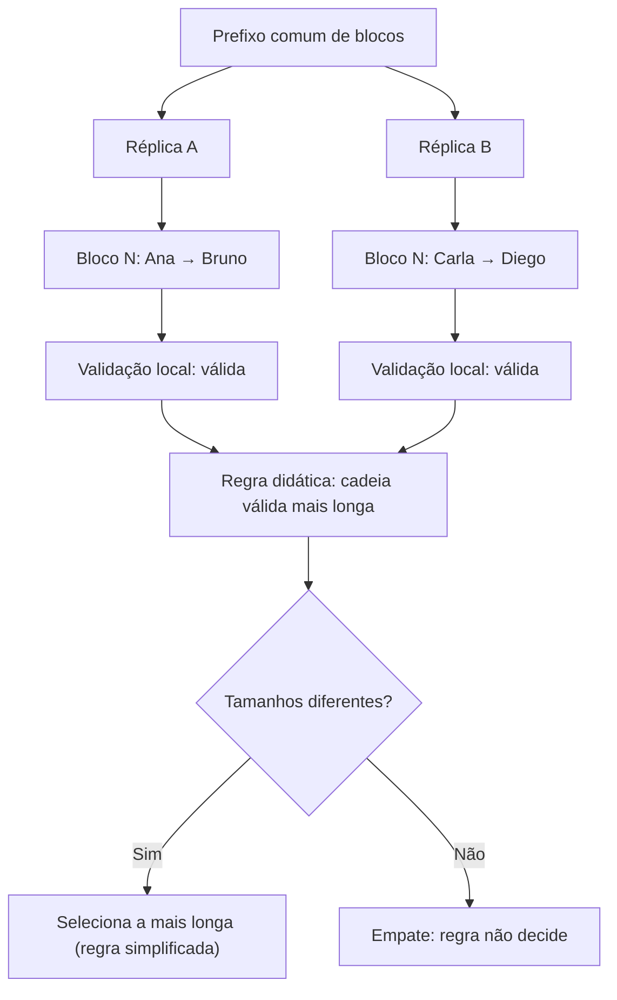

# Diagrama — réplicas divergentes

O diagrama mostra que duas réplicas podem ter um prefixo comum e depois divergir. A validade local não resolve a divergência. A regra da cadeia mais longa é usada apenas para discussão; não constitui, isoladamente, um protocolo seguro de consenso.
